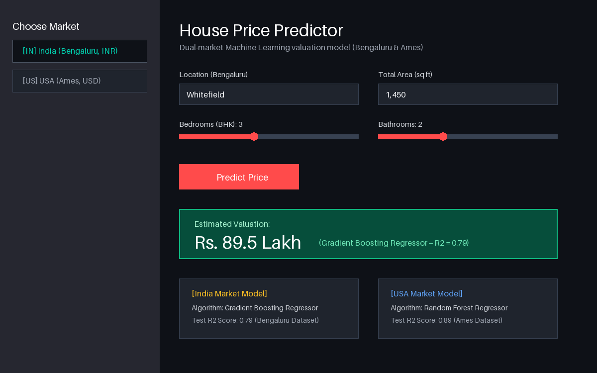

<div align="center">

# 🏡 Dual-Market House Price Prediction & Web App
### *Machine Learning Real Estate Valuation Models (India & USA)*

[](https://www.python.org/)
[](https://streamlit.io/)
[](https://scikit-learn.org/)
[](https://pandas.pydata.org/)
[](LICENSE)
[](https://house-price-prediction-isncgvvwk89mvcahtd33rr.streamlit.app/)

[Live Demo](https://house-price-prediction-isncgvvwk89mvcahtd33rr.streamlit.app/) • [About This Project](#-about-this-project) • [Key Features](#-key-features) • [Model & Results](#-model-architecture--results) • [How to Run](#-how-to-run-locally) • [License](#-license) • [What I Learned](#-key-learnings--takeaways)

</div>

---

## 🚀 Live Demo

Try the interactive valuation app in your browser:  
👉 **[Launch House Price Predictor](https://house-price-prediction-isncgvvwk89mvcahtd33rr.streamlit.app/)**

<br>

<div align="center">
  
</div>

---

## 📖 About This Project

Hi! I'm **Deepak Pradhan**, a student learning and progressing in **Machine Learning and Applied Data Science**.

Predicting property values is a classic regression problem, but real estate dynamics vary drastically across different global markets. In this project, I wanted to go beyond single-dataset tutorials and compare two distinct real estate environments:

1. **🇮🇳 Indian Market (Bengaluru):** Driven by hyper-local micro-markets (neighborhoods like Whitefield, Indira Nagar, Electronic City), square footage, and configuration (BHK, bathrooms).
2. **🇺🇸 US Market (Ames, Iowa):** Driven by structural build characteristics, overall construction quality ratings (1–10), finished basement area, garage capacity, and year built.

Rather than leaving this as static analysis code in notebooks, I packaged both trained regression pipelines into an interactive **Streamlit** web app where users can toggle between markets, adjust parameters, and receive instant valuations formatted in local currencies (₹ Lakh/Crore and $ USD).

---

## ✨ Key Features

| Feature | Description |
| :--- | :--- |
| **🌐 Dual-Market Toggle** | Switch seamlessly between Bengaluru (India) and Ames (USA) models via the sidebar. |
| **📍 Location-Aware Pricing** | Over 100+ encoded Bengaluru localities handled via specialized one-hot mapping. |
| **🎛️ Real-Time Sliders & Inputs** | Dynamic sliders for Area (sq ft), BHK, Bathrooms, Construction Quality, Garage Capacity, and Year Built. |
| **💰 Localized Currency Formatting** | Automatically formats Indian valuations into **Lakhs / Crores (₹)** and US valuations into **USD ($)** with comma separation. |
| **⚡ Fast In-Memory Predictions** | Pre-trained model artifacts (`model.pkl` and `model_india.pkl`) loaded with zero retraining latency. |

---

## 📊 Model Architecture & Results

### 1. Model Comparison & Metrics

| Market | Dataset | Algorithm | Test $R^2$ Score | Key Predictors |
| :--- | :--- | :--- | :--- | :--- |
| **🇺🇸 USA (Ames)** | Kaggle Ames Housing Dataset | **Random Forest Regressor** | **0.89 (89%)** | Overall Quality, Living Area (`GrLivArea`), Total Basement SF, Garage Size |
| **🇮🇳 India (Bengaluru)** | Bengaluru House Price Dataset | **Gradient Boosting Regressor** | **0.79 (79%)** | Prime Location, Total Square Feet, BHK Count, Bathroom Count |

### 2. Preprocessing & Feature Engineering
- **Missing Value Handling:** Median imputation for continuous variables (`TotalBsmtSF`, `LotFrontage`) to prevent outlier skewing.
- **Dimensionality Reduction on Categorical Localities:** Clustered rare localities (<10 data points) into an `"Other"` category to prevent high-cardinality overfitting in the Indian model.
- **Outlier Removal:** Filtered abnormal price-per-square-foot spikes and invalid BHK-to-area ratios (e.g. 8 BHK in 400 sq ft).

---

## 📂 Project Structure

```text
house_price-prediction/
│
├── data/
│   ├── train.csv            # Kaggle Ames housing dataset
│   └── Bengaluru_House_Data.csv # Bengaluru property dataset
├── app.py                   # Streamlit web application
├── analysis.ipynb           # USA housing EDA, preprocessing & Random Forest training
├── india_model.ipynb        # India housing EDA & Gradient Boosting pipeline
├── model.pkl                # Trained model pipeline artifact (USA)
├── model_india.pkl          # Trained model pipeline artifact (India)
├── screenshot.png           # Application preview screenshot
├── requirements.txt         # Minimal production dependencies
├── .gitignore               # Ignored cache & virtual environment files
└── README.md                # Project documentation
```

---

## 💻 How to Run Locally

If you'd like to run this application on your local machine:

### 1. Clone the repository
```bash
git clone https://github.com/deepakpradhan1021/house-price-prediction.git
cd house-price-prediction
```

### 2. Set up a virtual environment
```bash
# Windows
python -m venv .venv
.\.venv\Scripts\activate

# macOS / Linux
python3 -m venv .venv
source .venv/bin/activate
```

### 3. Install dependencies
```bash
pip install -r requirements.txt
```

### 4. Launch the Streamlit application
```bash
streamlit run app.py
```
Open your browser at **`http://localhost:8501`**.

---

## 💡 Key Learnings & Takeaways

- **Handling High-Cardinality Categoricals:** Learning how one-hot encoding on hundreds of neighborhood names can cause memory spikes and overfitting, and how frequency grouping solves it.
- **Metric Evaluation ($R^2$ vs. MAE/RMSE):** Understanding that $R^2$ measures explained variance, while Mean Absolute Error gives concrete monetary interpretation for home buyers.
- **Model Serialization & Deployment:** Saving pipelines with `joblib` so that spatial encoders and regression weights are bundled into lightweight artifacts ready for cloud hosting.
- **Cross-Market Generalization:** Realizing that features essential in one country (e.g., central heating and basement area in Iowa) are irrelevant in tropical urban markets like Bengaluru.

---

## 🔮 Future Improvements

- [ ] Incorporate interactive price distribution maps using Folium or PyDeck.
- [ ] Experiment with XGBoost and CatBoost for improved performance on categorical locations.
- [ ] Add mortgage and EMI calculation estimates based on current interest rates.

## 📜 License

This project is open source and available under the [MIT License](LICENSE).

---

## 👤 Author

**Deepak Pradhan**
- 🐙 GitHub: [@deepakpradhan1021](https://github.com/deepakpradhan1021)
- 🚀 Live App: [Streamlit Deployment](https://house-price-prediction-isncgvvwk89mvcahtd33rr.streamlit.app/)
- *Always open to constructive feedback, suggestions, and learning opportunities!*
